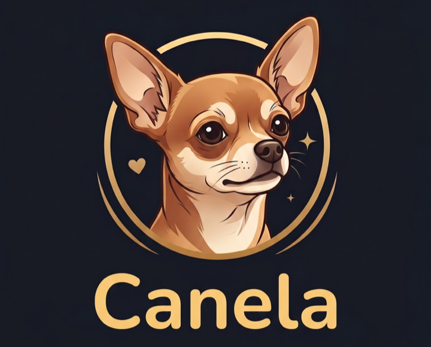

CANELA: Clean And Native Editor for Live Authoring. A live Markdown and HTML editor written in Hilde on Wolly

# Canela

One surface: Markdown is shown formatted while you type, and the file on
disk stays plain Markdown. Canela is a native app for macOS and Linux
(GTK 4) and runs in the browser as WebAssembly (see
[Web editor (WASM)](#web-editor-wasm)). It is written in
[Hilde](https://github.com/heikozim/hilde); the core (document model,
editing, undo, Markdown and HTML in and out) lives in
[Wolly](https://github.com/heikozim/hilde-wolly).

## Features

- **Live Markdown**: tables as grids, task lists, footnotes, `[toc]`,
  callouts (`[!NOTE]`, `[!TIP]`, ...), syntax-highlighted code, emoji
- **HTML mode**: `.html` files edited as clean HTML; paste converts HTML
  to Markdown and back
- **Math**: LaTeX formulas with matrices, cases and aligned equations
- **Plots and tables from data**: `plot` and `table` code blocks from CSV
  or JSON (line, bar, scatter, histogram, error bars)
- **Writing for print**: citations from BibTeX, cross references,
  numbered sections, index, books from chapters, publisher CSS
- **Export**: HTML, PDF, EPUB, LaTeX, Word (DOCX), OpenDocument (ODT)
- **Pictures**: PNG, JPEG, SVG and JPEG XL; drop or paste, rotate, mirror
- **Tools**: format overlay, command palette, find and replace, search in
  files, outline, focus and typewriter mode, themes, spell and grammar
  check (own LanguageTool server), versions, statistics
- **MCP server**: `canela --mcp` lets an MCP client read and edit the open
  documents
- **MIRCO cells**: computed code blocks with the science kit
  [MIRCO](https://github.com/heikozim/hilde-mirco)
- English and German user interface

## Quick start

Canela needs a Hilde tree and a Wolly tree beside it.

```sh
# macOS: Canela.app
bash app/macos/build.sh ../hilde-wolly ../hilde out
out/Canela.app/Contents/MacOS/canela notes.md

# Linux (GTK 4) and a Debian package
bash app/linux/build.sh ../hilde-wolly ../hilde out
bash app/linux/deb.sh out/canela "$(cat VERSION)" out
```

## Web editor (WASM)

The same editor runs in the browser: the core of Canela built with Hilde
for wasm32-wasi, drawn into the DOM by `app/wasm/canela.js`. It is a
drop-in replacement for CKEditor: the toolbar names are the same.

| | Canela (WASM) | CKEditor |
|---|---|---|
| Transferred to the browser | about 254 KB (canela.wasm 581 KB stripped) | 562 KB |

Build `canela.wasm` with a Hilde compiler and zig, from the Hilde tree
beside this one:

```sh
cd ../hilde
./hilde build --target-type=wasm ../hilde-canela/app/wasm/Wasm.hiq \
    --modules=bindings/generated:standard/src:../hilde-wolly/src \
    --output=../hilde-canela/app/wasm/canela.wasm
```

(`app/wasm/build-in-image.sh` does the same in a container and runs the
tests.) Embed it in a page:

```html
<div id="content"></div>
<script type="module">
import { Canela } from "./canela.js";
const editor = await Canela.create(document.getElementById("content"), {
  mode: "markdown",            // or "html", "plain"
  input: "html", output: "html",
  toolbar: ["heading", "bold", "italic", "link", "bulletedList", "image", "undo", "redo"],
  locale: "en",
  upload: async (file, name) => {
    // store the picture on your server and answer its URL
    const r = await fetch("/upload", { method: "POST", body: file });
    return (await r.json()).url;
  },
  onChange: (editor) => {},
});
editor.getData(); editor.setData("<p>Hello</p>"); editor.destroy();
</script>
```

Without `upload` the picture button is hidden. A local demo, with
`canela.wasm` in `app/wasm/`:

```sh
cd app/wasm && python3 -m http.server 8000
# open http://localhost:8000/demo.html
```

## Shortcuts

| Shortcut | Action |
|----------|--------|
| `Option+Return`, or `/` on an empty line | Format overlay: every format with preview, syntax and shortcut |
| `Shift+Cmd+P` | Command palette |
| `Cmd+B`, `Cmd+I`, `Cmd+E` | Bold, italic, inline code |
| `Shift+Cmd+X`, `Shift+Cmd+H`, `Cmd+K` | Strikethrough, highlight, link |
| `Cmd+1` ... `Cmd+6`, `Cmd+0` | Heading 1 to 6, paragraph |
| `Tab`, `Shift+Tab` | Next, previous table cell |
| `Cmd+F`, `Option+Cmd+F` | Find, replace |
| `Shift+Cmd+F` | Search in files |
| `Shift+Cmd+L`, `Ctrl+Cmd+S` | Outline, sidebar |
| `Cmd+/` | Show the source (Markdown or HTML) |
| `Shift+Cmd+M` | Convert the document Markdown <-> HTML |
| `F8`, `F9` | Focus mode, typewriter mode |
| `Shift+Cmd+E`, `Option+Cmd+E` | Export HTML, PDF |
| `Option+Cmd+G` | Grammar check |
| `Cmd+,` | Settings |

Every command is also in the menu bar with its shortcut. Control works
like Cmd for all letter and digit shortcuts.

## MCP

Canela is a server of the Model Context Protocol. An MCP client starts it
as `canela --mcp` over stdin and stdout. When Canela is already running,
edits go into the open window, each one an undo step; otherwise
`canela --mcp` works on the files itself.

| Tool | Purpose |
|------|---------|
| `list_open_documents`, `open_document`, `read_document` | Find and read documents |
| `replace_text`, `insert_text`, `apply_edit`, `get_selection` | Edit |
| `save_document`, `export_document` | Save; export to HTML, PDF, EPUB, LaTeX, DOCX or ODT |

Only absolute paths to `.md`, `.markdown`, `.txt`, `.html` and `.htm`;
nothing changes on disk before `save_document`, nothing is deleted.

```json
{
  "mcpServers": {
    "canela": {
      "command": "/Applications/Canela.app/Contents/MacOS/canela",
      "args": ["--mcp"]
    }
  }
}
```

## Testing

| Command | Checks |
|---------|--------|
| `sh scripts/gate.sh` | Naming rules of Hilde |
| `bash app/linux/smoke.sh <canela> <dir>` | Linux smoke runs under Xvfb: window, grammar, tables, pictures, exports |
| `node app/wasm/test.mjs canela.wasm` | The WebAssembly build: HTML in, edits, HTML out |

## License

Copyright (c) 2026 Heiko Zimmermann <code@heiko-zimmermann.com>

Canela is licensed under the Apache License 2.0 with LLVM Exceptions; see LICENSE.
Issues, questions and patches go to code@heiko-zimmermann.com.
